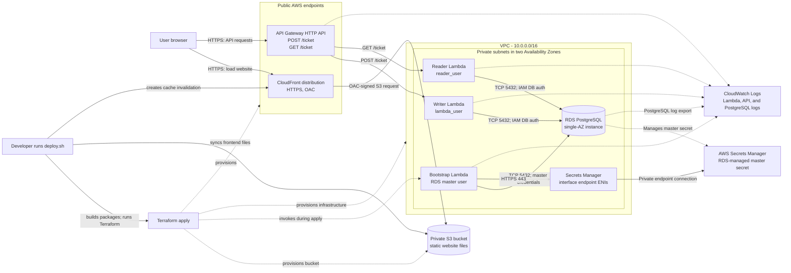

# Groundwork - Phase 1 Architecture

## Current architecture

# VPC Design
- This project only requires a private subnet; no public subnet or internet access is required.
    - Subnets stay private because no `IGW` or `NAT gateway` was attached.
    - The subnets use the VPC’s main `route table`; the VPC-local route supports routing between VPC address ranges. There is no declared route to an `internet gateway` or `NAT gateway`.
        - This is fine because the VPC only contains private subnets. If there is a need to distinguish private and public subnets, for example, custom `route tables` can help organize traffic routing within the VPC.
        - This allows the possibility for resources to talk to each other, but we still need to configure `security groups` to allow that traffic. Refer to the networking section for more information.
    - The default `NACL` allows all inbound and outbound traffic and is stateless. It filters traffic but does not create routes. `Security groups` provide additional traffic controls.
## Inputs and outputs
### Inputs
- `vpc_cidr_block`
    - To specify IP range the VPC will have
- `subnets`
    - Specify the name of each subnet as well as the CIDR block they will hold within the VPC
    - The module will spread the subnets across `AZs` discovered for the VPC within its created region
### Outputs
- `vpc_id`
    - ID of the VPC, which will be used by other modules to know where to create resources in which VPC
- `private_subnet_ids`
    - IDs of the private subnets, resources created in the private subnets will require it to know which subnet the resource exists in 

# Networking module
- Defines the `security groups` for resources within the private subnet. These control which resources can communicate with each other and restrict access to explicitly allowed traffic paths.
- A `Secrets Manager` interface endpoint is also created here.
    - `Secrets Manager` is an AWS service that does not live inside the VPC; an interface endpoint provides a private path between the VPC and the service.

## Security groups that exist
- The module defines five security groups: one each for RDS, the writer Lambda, the reader Lambda, the bootstrap Lambda, and the `Secrets Manager` endpoint. The reader and writer Lambdas have the same current network requirements, so their groups could technically be shared.

### Lambda reader and writer
- These two require egress traffic to the `RDS` database so they can read or insert data and receive database responses.
- Their `security groups` allow outbound traffic to the `RDS` database on `TCP/5432`.
- `Security groups`, unlike `NACLs`, are stateful, so separate Lambda ingress rules are not needed for responses to connections initiated by Lambda.

### RDS database
- The `RDS` security group has ingress rules from each Lambda security group on `TCP/5432`, allowing the functions to initiate database connections.

### Lambda bootstrap
- The bootstrap function requires egress traffic to the `RDS` database and to the `Secrets Manager` interface endpoint.
- Unlike the other Lambda functions, which use `IAM database authentication`, this function retrieves the RDS-managed master password from `Secrets Manager`.

### Secrets manager
- This module does not provision `Secrets Manager`; it creates the interface endpoint that provides private network connectivity from the VPC to the service.
- The endpoint security group allows ingress on `TCP/443` from the bootstrap Lambda security group. IAM separately authorizes the Lambda to retrieve the RDS-managed master password.

## Inputs and outputs
### Inputs
- `region`
    - AWS region used to construct the `Secrets Manager` endpoint service name.
- `vpc_id`
    - VPC in which the security groups and interface endpoint are created.
- `subnet_ids`
    - Subnets in which the `Secrets Manager` interface endpoint creates its network interfaces (`ENIs`). They need not be the same subnets as the workload, provided the workloads can reach the endpoint.
### Outputs
- `rds_security_group_id`, `lambda_app_security_group_id`, `lambda_reader_security_group_id`, `bootstrap_security_group_id`, and `secretsmanager_endpoint_security_group_id`
    - IDs passed to the respective resource modules so they can attach the previously defined security groups. Defining the groups and their cross-referencing rules in this module avoids circular dependencies.

# RDS
- The DB subnet group defines the subnets in which RDS can place the database. It must include subnets in at least two Availability Zones; this does not by itself make the database Multi-AZ.
- The RDS instance is configured as a single-AZ deployment; no Multi-AZ setting is enabled.
- PostgreSQL logs are available through RDS. `enabled_cloudwatch_logs_exports = ["postgresql"]` additionally exports them to CloudWatch Logs.
    - The CloudWatch log group is pre-created so its retention period and tags are managed by Terraform.
    - The log group retains the CloudWatch copy for 7 days; this does not set the retention period for logs available through RDS.
- Storage encryption is enabled for the DB instance.
- IAM database authentication is enabled. The master password is managed by RDS in Secrets Manager for the bootstrap Lambda to retrieve.
- `skip_final_snapshot = true` means Terraform can delete the instance without taking a final snapshot. This simplifies teardown for a disposable learning environment, but deleting the instance this way does not preserve its data in a final snapshot.
## Inputs and outputs
### Inputs
- rds-security-group-id
    - Security group attached to RDS; the networking module defines the ingress rules that control which Lambda security groups can connect
- subnet-ids
    - Subnets used to create the DB subnet group; they must span at least two Availability Zones
- instance class
    - RDS DB instance class that determines the database instance's compute and memory capacity
- engine version
    - PostgreSQL engine version
- db name
    - Initial database name configured on the RDS instance; it must match the database name used by the bootstrap SQL
- allocated-storage
    - Storage allocated to the DB instance; this project configures 20 GB
### Outputs
- rds endpoint
    - RDS hostname passed to the bootstrap, writer, and reader Lambdas so they can connect to the database
- rds db resource id
    - RDS DB resource ID used to construct the IAM database authentication `rds-db:connect` ARN
- master-secret-arn
    - ARN the bootstrap Lambda uses to retrieve the RDS-managed master password from Secrets Manager
- master-username
    - Master database username passed to the bootstrap Lambda
## IAM policies
- This module does not define IAM permissions for managing the RDS instance. AWS IAM permissions on the deployment identity determine who can modify its configuration.

# Bootstrap lambda
- The bootstrap Lambda connects to PostgreSQL as the RDS master user and applies `app/bootstrap/rds_bootstrap.sql`.
- The SQL creates the `tickets` table and the application database users, then grants the reader and writer users their database privileges.
- The SQL and handler are designed to be idempotent so Terraform can invoke the bootstrap again safely.
- Terraform invokes the function through an `aws_lambda_invocation` resource during apply.
    - The invocation resource runs when it is created and is triggered again when the packaged bootstrap code hash changes.
    - A code-hash change does not necessarily mean the database schema changed; it can result from any packaged source or dependency change.
- `build.sh` assembles the bootstrap files and dependencies in `build/bootstrap`. Terraform's `archive_file` data source packages that directory into the Lambda deployment archive.

## Inputs and outputs
### Inputs
- lambda-name
    - Lambda function name; defaults to `groundwork_rds_bootstrap`
- source-dir
    - Directory containing the handler, SQL file, dependencies, and CA bundle to package
- handler
    - Lambda handler entry point; defaults to `handler.lambda_handler`
- runtime
    - Lambda runtime; defaults to Python 3.12
- timeout
    - Maximum execution time in seconds; defaults to 60
- subnet-ids
    - VPC subnets in which Lambda creates its network interfaces
- bootstrap-security-group-id
    - Security group attached to the Lambda; its rules allow connections to RDS and the Secrets Manager interface endpoint
- rds-endpoint
    - RDS hostname used by the handler to connect to PostgreSQL
- db-name
    - Database name the handler connects to before applying the bootstrap SQL; keep it aligned with the database name hard-coded in the SQL grant
- master-username
    - RDS master username passed to the handler as an environment variable
- master-secret-arn
    - ARN of the RDS-managed master secret; the handler uses it to retrieve the database password
- log-retention-days
    - CloudWatch log retention period; defaults to 7 days
### Outputs
- bootstrap-result
    - Result returned by the Lambda invocation; exposed by the module but not currently consumed by the root module
## IAM policies
- The role trust policy allows the Lambda service (`lambda.amazonaws.com`) to assume the execution role used by the function.
- The role has an inline policy granting `secretsmanager:GetSecretValue` only for the supplied RDS master-secret ARN.
- A separate inline policy allows `logs:CreateLogStream` and `logs:PutLogEvents` only for streams in this function's pre-created CloudWatch log group.
- The role also receives the AWS-managed `AWSLambdaENIManagementAccess` policy to manage the network interfaces needed for VPC connectivity.
- The handler does not catch bootstrap exceptions; a failed invocation is surfaced during the Terraform apply rather than being returned as a success-shaped result.

# DB Lambdas

- The shared `db_lambda` Terraform module deploys two separate VPC-connected Lambda functions: a writer and a reader.
- Both authenticate to PostgreSQL using IAM database authentication. Each handler asks the RDS API to generate a short-lived authentication token, then connects to the database over TLS with certificate verification.
- The writer validates POST request bodies and inserts tickets using the `lambda_user` PostgreSQL account.
- The reader uses the `reader_user` account to select up to 20 tickets and masks email addresses in its response.
- The writer and reader use separate Lambda execution roles, database users, security groups, and CloudWatch log groups.
- `build.sh` assembles each function's code and dependencies under `build/app_lambda` and `build/reader`; Terraform packages each directory for deployment.

## Inputs and outputs
### Inputs
- region
    - AWS region used to construct the IAM `rds-db:connect` resource ARN and generate database authentication tokens
- lambda-name
    - Name of the Lambda function and its associated role and log group
- source-dir
    - Directory containing the handler and runtime dependencies to package
- handler
    - Lambda handler entry point in `file.function` format
- runtime
    - Lambda runtime; defaults to Python 3.12
- timeout
    - Maximum function execution time in seconds; defaults to 15
- memory-size
    - Lambda memory allocation in MB; defaults to 256
- subnet-ids
    - VPC subnets in which Lambda creates its network interfaces
- security-group-id
    - Security group attached to this Lambda; its rules allow database traffic to RDS
- db-name
    - PostgreSQL database name provided to the handler as an environment variable
- db-user
    - PostgreSQL IAM-authenticated database user; the module scopes `rds-db:connect` to this user
- rds-endpoint
    - RDS hostname provided to the handler as an environment variable
- db-resource-id
    - RDS DB resource identifier used to scope the `rds-db:connect` permission
### Outputs
- lambda-function-arn
    - ARN of the deployed function
- lambda-function-name
    - Name of the deployed function
- lambda-invoke-arn
    - Invoke ARN used by the API Gateway integration
- The root module passes the function name and invoke ARN to API Gateway, which separately creates the Lambda resource-based invoke permission for each route.

## IAM policies
- Each function has its own execution role, trusted by the Lambda service.
- An inline policy grants `rds-db:connect` only for the configured DB resource ID and database username. The writer and reader therefore receive access as different database users.
- A separate inline policy grants `logs:CreateLogStream` and `logs:PutLogEvents` only for that function's pre-created CloudWatch log group.
- The role receives the AWS-managed `AWSLambdaENIManagementAccess` policy for VPC network-interface management.
- These IAM permissions enable IAM database authentication and logging; PostgreSQL grants separately control what each database user can do. The bootstrap SQL grants the writer `INSERT` access and the reader `SELECT` access.

# API Gateway
- The module uses `aws_apigatewayv2_api` with `protocol_type = "HTTP"` to create an API Gateway HTTP API. HTTP APIs are generally simpler and have fewer features than API Gateway REST APIs.
- The root module currently configures two routes: `POST /ticket` to the writer Lambda and `GET /ticket` to the reader Lambda.
- Each route is represented by a route key (`METHOD /path`) and mapped to an API Gateway Lambda proxy integration. The integration uses the Lambda invoke ARN as its target.
- The route module accepts `GET`, `POST`, `PUT`, `PATCH`, and `DELETE` route keys. This is separate from the CORS method list, which permits browser requests using `GET`, `POST`, and `OPTIONS`.
- For each route, `aws_lambda_permission` adds a statement to the target Lambda's resource-based policy. It allows the API Gateway service principal to invoke that function, constrained by a source ARN for the API, stage, method, and path.
- The API configures CORS to allow the CloudFront website origin supplied by the root module, with the `content-type` header and a 300-second max age.
- A `$default` stage is configured with automatic deployment. API access logs are written as JSON to a pre-created CloudWatch log group with seven-day retention.
- The stage applies API-wide rate and burst throttling settings. The burst limit is a short-term request burst allowance, not a direct concurrent-request limit.
## Inputs and outputs
### Inputs
- api_name
    - Name assigned to the HTTP API and used in its access-log group
- routes
    - Map of route keys to Lambda invoke ARNs and function names; route keys must use a supported HTTP method and path format
- cors_allow_origins
    - Browser origins allowed by the API's CORS configuration
- throttling_rate_limit
    - Steady-state API request rate limit; defaults to 5 requests per second
- throttling_burst_limit
    - API burst request limit; defaults to 10
### Outputs
- invoke_url
    - Base API endpoint URL, passed to the frontend configuration by `deploy.sh`
## IAM policies
- API Gateway does not use a Lambda execution role in this configuration. `aws_lambda_permission` grants API Gateway permission to invoke each target Lambda; the Lambda execution roles separately govern what the function code can access.

# S3 and cloudfront
- The S3 bucket name includes a random suffix to make a globally unique name.
- The bucket blocks public access, enforces bucket-owner ownership, uses AES256 server-side encryption, and has versioning enabled.
- `force_destroy = true` allows Terraform to delete a non-empty bucket, including its object versions. This makes teardown easier but risks permanent data loss.
- CloudFront uses the bucket's regional S3 endpoint as its origin and an Origin Access Control (OAC) that signs origin requests with SigV4.
- The S3 origin block contains an empty legacy Origin Access Identity value; OAC is configured separately on the origin and is the access-control mechanism used here.
- The bucket policy grants the CloudFront service principal `s3:GetObject` on bucket objects only when the request's `AWS:SourceArn` matches this distribution. Combined with S3 Block Public Access, this keeps direct public bucket access blocked while allowing this distribution to read objects.
- The distribution serves `index.html` as its default root object, accepts and caches `GET` and `HEAD`, and redirects viewer HTTP requests to HTTPS.
- No custom cache policy or TTL is configured. The behavior uses the legacy `forwarded_values` settings (no query strings or cookies forwarded) and CloudFront's default cache behavior settings; this is not equivalent to disabling caching.
- Geo restrictions are disabled. The distribution uses the default CloudFront certificate; there is no custom domain or certificate configured.

## Inputs and outputs
### Outputs
- website_bucket_name
    - Passed to `deploy.sh` so it can synchronize the generated frontend files to the bucket
- cloudfront_distribution_id
    - Passed to `deploy.sh` so it can create a cache invalidation after upload
- cloudfront_domain_name
    - Used by the root module to set the API's allowed CORS origin
- website_url
    - Exposed as a Terraform output and printed by `deploy.sh` when deployment completes
## IAM policies
- The bucket policy allows the CloudFront service principal to perform `s3:GetObject` on objects in this bucket only for this distribution. It does not grant CloudFront permission to write objects or list the bucket.